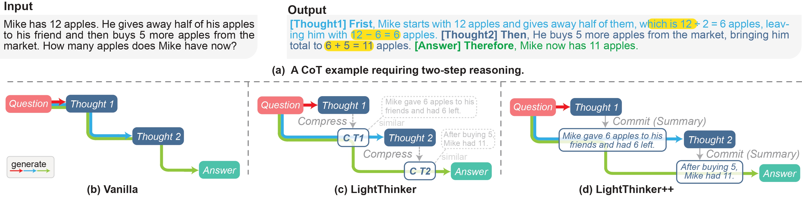

<div align="center">
<h1 align="center"> 👉 LightThinker 👈 </h1>
<b>LightThinker Family: From Thinking Compression to Adaptive Memory Management</b>

[](https://github.com/zjunlp/LightThinker)
[](https://opensource.org/licenses/MIT)


<p align="center">
  <a href="https://arxiv.org/abs/2502.15589">📄 LightThinker arXiv</a> •
  <a href="http://arxiv.org/abs/2604.03679">📄 LightThinker++ arXiv</a> •
  <a href="https://huggingface.co/collections/zjunlp/lightthinker-67f9faaaa518f2e00b17386b">🤗 Hugging Face</a>
</p>
</div>

<div align="center" style="width: 100%;">
  
</div>

## Table of Contents

- 🔔 [News](#news)
- 👀 [Overview](#overview)
- 🤗 [Resources](#resources)
- 📁 [Repository Structure](#repository-structure)
- 🚀 [LightThinker++ — General Reasoning](#lightthinker--general-reasoning)
- 🌐 [LightThinker++ — Agentic Reasoning](#lightthinker--agentic-reasoning)
- 💡 [LightThinker](#lightthinker)
- 🎁 [Acknowledgement](#acknowledgement)
- 🚩 [Citation](#citation)

## 🔔 News

- **[2026-03]** We release a new paper: "[LightThinker++: From Reasoning Compression to Memory Management](http://arxiv.org/abs/2604.03679)".
- **[2025-08]** Our paper "[LightThinker: Thinking Step-by-Step Compression](https://arxiv.org/abs/2502.15589)" has been accepted to EMNLP 2025.
- **[2025-02]** We release "[LightThinker: Thinking Step-by-Step Compression](https://arxiv.org/abs/2502.15589)".

## 👀 Overview

LLMs can solve increasingly complex reasoning tasks, but long thought traces make inference expensive because the model must retain and attend to large contexts. The **LightThinker family** addresses this by compressing or actively managing intermediate reasoning states.

- **LightThinker** compresses intermediate thoughts into compact gist-token representations. The implementation and AnLLM baseline are preserved under [`lightthinker_v1/`](./lightthinker_v1/).
- **LightThinker++** introduces explicit adaptive memory management. The model can use memory primitives such as `commit`, `expand`, `fold`, and `final_answer` to control its scratchpad while reasoning.

This top-level README is a quick-start guide. Detailed model links, data links, environment variables, script parameters, and evaluation options live in the module README files.

## 🤗 Resources

- **LightThinker++ General Reasoning:** models, SFT data, and full configuration are in [`general_reasoning/README.md`](./general_reasoning/README.md).
- **LightThinker++ Agentic Reasoning:** models, SFT data, and full configuration are in [`agentic_reasoning/README.md`](./agentic_reasoning/README.md).
- **LightThinker:** models, data archive, and full configuration are in [`lightthinker_v1/README.md`](./lightthinker_v1/README.md).

## 📁 Repository Structure

```
LightThinker/
├── general_reasoning/       # LightThinker++ for math and general reasoning tasks
├── agentic_reasoning/       # LightThinker++ for agentic deep-research tasks
├── lightthinker_v1/         # LightThinker and AnLLM baseline code
├── assets/                  # README assets
└── README.md
```

| Method | Folder | Full guide |
|--------|--------|------------|
| LightThinker++ for general reasoning | [`general_reasoning/`](./general_reasoning/) | [`general_reasoning/README.md`](./general_reasoning/README.md) |
| LightThinker++ for agentic reasoning | [`agentic_reasoning/`](./agentic_reasoning/) | [`agentic_reasoning/README.md`](./agentic_reasoning/README.md) |
| LightThinker | [`lightthinker_v1/`](./lightthinker_v1/) | [`lightthinker_v1/README.md`](./lightthinker_v1/README.md) |

## 🚀 LightThinker++ — General Reasoning

Quick start for math and general reasoning tasks such as GSM8K, MMLU, GPQA, and BBH:

```bash
cd general_reasoning
conda env create -f environment.yml
conda activate lt_plus_general_reasoning
cp .env.example ../.env

# Generate synthetic trajectories after setting an input JSONL dataset.
DATASET_PATH=/path/to/input.jsonl bash scripts/synthetic.sh

# Run inference with a trained or downloaded model.
MODEL=/path/to/model bash scripts/infer.sh 0 gsm8k
```

See [`general_reasoning/README.md`](./general_reasoning/README.md) for configuration, datasets, and full arguments.

## 🌐 LightThinker++ — Agentic Reasoning

Quick start for long-horizon deep-research and multi-hop QA tasks:

```bash
cd agentic_reasoning
bash setup.sh
cp .env.synthetic.example .env

# Run synthetic data generation with the included sample dataset.
bash scripts/synthetic.sh
```

For inference, use `cp .env.infer.example .env`, configure your model endpoint, and run `bash scripts/inference.sh`.

See [`agentic_reasoning/README.md`](./agentic_reasoning/README.md) for configuration, datasets, and full arguments.

## 💡 LightThinker

Quick start for the LightThinker implementation:

```bash
cd lightthinker_v1
conda create -n lightthinker python=3.9 -y
conda activate lightthinker
pip install -r requirements.txt

# Train and run inference.
bash train.sh
bash inference.sh
```

See [`lightthinker_v1/README.md`](./lightthinker_v1/README.md) for configuration, datasets, and full arguments.

## 🎁 Acknowledgement

We use the [`ms-swift`](https://github.com/modelscope/ms-swift) framework for full-parameter SFT of the LightThinker++ models. The general reasoning evaluation also builds on ideas from [TokenSkip](https://github.com/carriex/TokenSkip). The LightThinker evaluation includes baseline code inspired by H2O from [Meta-llama](https://github.com/meta-llama/llama-cookbook) and SepLLM from [HKUDS](https://github.com/HKUDS/SepLLM).

## 🚩 Citation

If this work is helpful, please kindly cite:

```bibtex
@article{lightthinker++,
  author       = {Yuqi Zhu and
                  Jintian Zhang and
                  Zhenjie Wan and
                  Yujie Luo and
                  Shuofei Qiao and
                  Zhengke Gui and
                  Da Zheng and
                  Lei Liang and
                  Huajun Chen and
                  Ningyu Zhang},
  title        = {LightThinker++: From Reasoning Compression to Memory Management},
  journal      = {CoRR},
  volume       = {abs/2604.03679},
  year         = {2026},
  url          = {https://doi.org/10.48550/arXiv.2604.03679},
  doi          = {10.48550/ARXIV.2604.03679},
  eprinttype   = {arXiv},
  eprint       = {2604.03679},
  timestamp    = {Fri, 08 May 2026 07:40:46 +0200},
  biburl       = {https://dblp.org/rec/journals/corr/abs-2604-03679.bib},
  bibsource    = {dblp computer science bibliography, https://dblp.org}
}

@inproceedings{lightthinker,
  author       = {Jintian Zhang and
                  Yuqi Zhu and
                  Mengshu Sun and
                  Yujie Luo and
                  Shuofei Qiao and
                  Lun Du and
                  Da Zheng and
                  Huajun Chen and
                  Ningyu Zhang},
  editor       = {Christos Christodoulopoulos and
                  Tanmoy Chakraborty and
                  Carolyn Rose and
                  Violet Peng},
  title        = {LightThinker: Thinking Step-by-Step Compression},
  booktitle    = {Proceedings of the 2025 Conference on Empirical Methods in Natural
                  Language Processing, {EMNLP} 2025, Suzhou, China, November 4-9, 2025},
  pages        = {13307--13328},
  publisher    = {Association for Computational Linguistics},
  year         = {2025},
  url          = {https://doi.org/10.18653/v1/2025.emnlp-main.673},
  doi          = {10.18653/V1/2025.EMNLP-MAIN.673},
  timestamp    = {Mon, 02 Feb 2026 09:39:37 +0100},
  biburl       = {https://dblp.org/rec/conf/emnlp/ZhangZSLQDZCZ25.bib},
  bibsource    = {dblp computer science bibliography, https://dblp.org}
}
```
